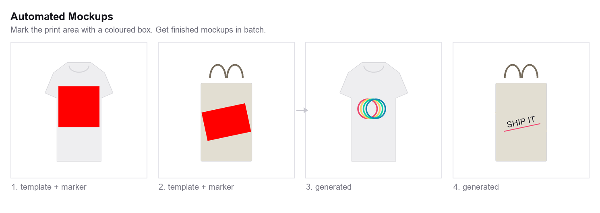

# Automated Mockup Generator

[](https://pypi.org/project/mockup-generator/)
[](https://www.python.org/downloads/)
[](https://opensource.org/licenses/MIT)
[](https://github.com/CTDave001/automated_mockups/actions/workflows/ci.yml)

**Automatically generate hundreds of product mockups in seconds.** Mark the print area on a template with a coloured box, and every design you have is placed into it — scaled, aligned, and rotated to match.



## Features

- **Batch Processing** - Generate all design x mockup combinations automatically
- **Smart Detection** - Automatically detects placeholder boxes by colour
- **Rotation Support** - Recovers the true tilt of angled print areas
- **Marker Removal** - Erases the placeholder so transparent designs don't sit on a coloured box
- **Flexible Alignment** - 9 alignment options (top-left to bottom-right)
- **Multiple Formats** - PNG, JPEG, WebP output support
- **Parallel Processing** - Fast generation with multi-threading
- **CLI & Python API** - Use from command line or integrate into your workflow

## Quick Start

### Installation

```bash
pip install mockup-generator
```

Or install from source:

```bash
git clone https://github.com/CTDave001/automated_mockups.git
cd automated_mockups
pip install -e .
```

### Try it immediately

The repository ships with working templates and designs, so you can see output before preparing anything of your own:

```bash
mockup-generator calculate --hex-color "#FF0000" --input examples/mockups/ --output examples/parameters.json
mockup-generator generate --params examples/parameters.json --designs examples/designs/ \
  --mockups examples/mockups/ --output examples/output/ --alignment center
```

That writes four mockups into `examples/output/`.

### Basic Usage

#### Step 1: Prepare Your Mockup Templates

Create mockup templates with a **coloured placeholder box** covering the area the design should fill:

```
mockups/
  ├── tshirt_front.png    # Has a red (#FF0000) box where the design goes
  ├── tshirt_back.png
  └── hoodie_front.png
```

The box may be tilted — draw it at whatever angle the product sits at, and the tilt is recovered automatically.

#### Step 2: Calculate Placeholder Positions

```bash
mockup-generator calculate --hex-color "#FF0000" --input mockups/ --output params.json
```

This analyses your mockups and saves the position, size, and rotation of each placeholder.

#### Step 3: Generate Mockups

```bash
mockup-generator generate \
  --params params.json \
  --designs designs/ \
  --mockups mockups/ \
  --output output/
```

That's it! Your `output/` folder now contains all combinations.

## How placement works

Each placeholder is modelled as a **rotated rectangle** — a centre, a width and height, and a tilt. Generation then:

1. Erases the marker box, so it can't show through a transparent design.
2. Scales your design to the box according to `--scale-mode`.
3. Aligns it within the box according to `--alignment`.
4. Rotates the result to the box's tilt and centres it on the box.

Alignment is applied *before* rotation, in the box's own frame, so `top_left` still means the top-left of the print area even when the product is photographed at an angle.

### Marker removal

Print-on-demand designs are usually transparent PNGs, which means anything not painted by the design would reveal the placeholder underneath. By default the marker is erased first, using a colour sampled from the template immediately around the box — so one batch can span a white tee and a natural-canvas tote without configuration.

Override or disable it when you need to:

```bash
# Erase to a specific colour instead of sampling
mockup-generator generate ... --placeholder-fill "#FFFFFF"

# Leave the marker in place (only sensible if designs are opaque and fill the box)
mockup-generator generate ... --keep-placeholder
```

## Python API

```python
from mockup_generator import MockupCalculator, MockupGenerator, Color

# Step 1: Calculate placeholder positions
calculator = MockupCalculator(Color.from_hex("#FF0000"))
params = calculator.process_directory("mockups/")
calculator.save_parameters(params, "params.json")

# Step 2: Generate mockups
generator = MockupGenerator(params)
results = generator.generate_all(
    design_dir="designs/",
    mockup_dir="mockups/",
    output_dir="output/"
)

print(f"Generated {len([r for r in results if r.success])} mockups!")
```

## CLI Reference

### Calculate Command

Analyses mockup templates to find placeholder boxes.

```bash
mockup-generator calculate [OPTIONS]

Options:
  --color R G B        Target colour as RGB (e.g., --color 255 0 0)
  --hex-color HEX      Target colour as hex (e.g., --hex-color "#FF0000")
  -i, --input DIR      Input directory with mockup templates (required)
  -o, --output FILE    Output JSON file (default: parameters.json)
  --tolerance N        Colour matching tolerance 0-255 (default: 30)
  --recursive          Process subdirectories
  -v, --verbose        Show detailed output
```

### Generate Command

Creates mockups from designs and templates.

```bash
mockup-generator generate [OPTIONS]

Options:
  -p, --params FILE      Parameters JSON file (required)
  -d, --designs DIR      Directory with design images (required)
  -m, --mockups DIR      Directory with mockup templates (required)
  -o, --output DIR       Output directory (required)
  --alignment ALIGN      Design alignment: top_left, top_center, top_right,
                         center_left, center, center_right, bottom_left,
                         bottom_center, bottom_right (default: top_center)
  --scale-mode MODE      Scaling: fit, fill, stretch, none (default: fit)
  --format FORMAT        Output format: PNG, JPEG, WEBP (default: PNG)
  --quality N            JPEG quality 1-100 (default: 95)
  --pattern PATTERN      Output naming pattern (default: {design}_{mockup})
  --placeholder-fill HEX Colour to erase the marker with (default: sampled)
  --keep-placeholder     Leave the marker visible
  --no-parallel          Disable parallel processing
  --workers N            Number of parallel workers (default: 4)
```

## Configuration Options

### Alignment Modes

| Alignment | Description |
|-----------|-------------|
| `top_left` | Design aligned to top-left of placeholder |
| `top_center` | Design centered horizontally, aligned to top |
| `top_right` | Design aligned to top-right |
| `center_left` | Design centered vertically, aligned to left |
| `center` | Design centered both ways |
| `center_right` | Design centered vertically, aligned to right |
| `bottom_left` | Design aligned to bottom-left |
| `bottom_center` | Design centered horizontally, aligned to bottom |
| `bottom_right` | Design aligned to bottom-right |

### Scale Modes

| Mode | Description |
|------|-------------|
| `fit` | Scale to fit within placeholder, maintaining aspect ratio |
| `fill` | Scale to fill placeholder completely (may crop) |
| `stretch` | Stretch to exact placeholder size (ignores aspect ratio) |
| `none` | Use original design size |

## Use Cases

- **Print-on-Demand** - Generate product previews for your POD store
- **E-commerce** - Create product images for multiple colours/variants
- **Marketing** - Quickly visualize designs on merchandise
- **Design Agencies** - Present client designs on realistic mockups
- **Social Media** - Generate promotional images at scale

## Project Structure

```
automated_mockups/
├── mockup_generator/
│   ├── __init__.py       # Package exports
│   ├── calculator.py     # Box position detection
│   ├── geometry.py       # Rotated-rectangle recovery
│   ├── generator.py      # Mockup generation
│   ├── cli.py            # Command-line interface
│   └── utils.py          # Utilities and helpers
├── examples/
│   ├── designs/          # Sample designs
│   ├── mockups/          # Sample templates
│   └── output/           # Generated mockups
├── tests/                # Test suite
├── pyproject.toml        # Package configuration
└── README.md
```

## Requirements

- Python 3.11+
- NumPy
- Pillow
- scikit-image
- SciPy

## Contributing

Contributions are welcome! Please see [CONTRIBUTING.md](CONTRIBUTING.md) for guidelines.

1. Fork the repository
2. Create a feature branch (`git checkout -b feature/amazing-feature`)
3. Commit your changes (`git commit -m 'Add amazing feature'`)
4. Push to the branch (`git push origin feature/amazing-feature`)
5. Open a Pull Request

Before opening a PR, please run the same checks CI does:

```bash
pip install -e ".[dev]"
ruff check mockup_generator/ tests/
black --check mockup_generator/ tests/
mypy mockup_generator/ --ignore-missing-imports
pytest
```

## License

This project is licensed under the MIT License - see the [LICENSE](LICENSE) file for details.

## Acknowledgments

- Built with [Pillow](https://pillow.readthedocs.io/) for image processing
- Region detection powered by [scikit-image](https://scikit-image.org/)

---

**Star this repo** if you find it useful! Questions? Open an [issue](https://github.com/CTDave001/automated_mockups/issues).
